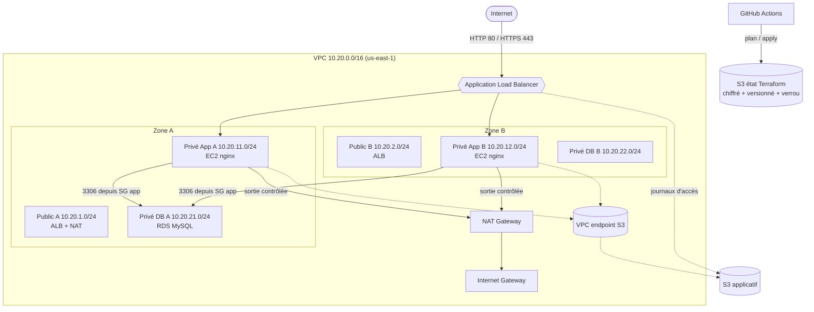

# Terraform Cloud Project : plateforme web hautement disponible sur AWS avec CI/CD

[](https://github.com/azizbnr9-rgb/terraform-cloud5-cicd/actions/workflows/terraform.yml)

Infrastructure Cloud modulaire, sécurisée et reproductible décrite avec Terraform, puis validée et déployée par un pipeline GitHub Actions. Elle héberge une application web derrière un Application Load Balancer, sur des instances privées réparties sur deux zones de disponibilité, avec une base RDS isolée.

## 1. Architecture



| Composant | dev | test | prod |
|-----------|-----|------|------|
| VPC | 10.20.0.0/16 | 10.30.0.0/16 | 10.40.0.0/16 |
| Sous-réseaux publics | 10.20.1.0/24, 10.20.2.0/24 | 10.30.1-2.0/24 | 10.40.1-2.0/24 |
| Sous-réseaux privés App | 10.20.11.0/24, 10.20.12.0/24 | 10.30.11-12.0/24 | 10.40.11-12.0/24 |
| Sous-réseaux privés DB | 10.20.21.0/24, 10.20.22.0/24 | 10.30.21-22.0/24 | 10.40.21-22.0/24 |
| NAT Gateway | 1 | 1 | 1 par zone |
| EC2 (ASG) | 2 à 4 × t3.micro | 2 à 3 × t3.micro | 2 à 6 × t3.small |
| RDS | db.t3.micro | db.t3.micro | db.t3.small Multi-AZ |
| Protection suppression | non | non | ALB + RDS |
| Déploiement | automatique (push main) | manuel + approbation | manuel + approbation |

Le schéma détaillé et les choix sont décrits dans [`docs/architecture.md`](docs/architecture.md), la sécurité dans [`docs/securite.md`](docs/securite.md), les coûts dans [`docs/couts.md`](docs/couts.md) et les résultats des tests dans [`docs/tests.md`](docs/tests.md).

## 2. Organisation du dépôt

```
terraform-cloud5-cicd/
├── .github/workflows/
│   ├── terraform.yml      # fmt, init, validate, plan, apply, destroy
│   ├── bootstrap.yml      # création du backend distant
│   └── tests.yml          # tests obligatoires sur un environnement déployé
├── bootstrap/             # bucket S3 de l'état + OIDC GitHub (optionnel)
├── modules/
│   ├── network/           # VPC, subnets, IGW, NAT, routes, endpoint S3
│   ├── security/          # Security Groups, rôle IAM d'instance
│   ├── load-balancer/     # ALB, listeners, target group, health check
│   ├── compute/           # Launch Template, user_data, ASG, scaling
│   ├── database/          # RDS, subnet group, paramètres
│   └── storage/           # S3 : versioning, chiffrement, cycle de vie
├── environments/{dev,test,prod}/   # appel des modules + variables + état séparés
├── scripts/               # bootstrap et tests
├── docs/                  # architecture, sécurité, coûts, tests, captures
├── .gitignore
├── README.md
└── LICENSE
```

Chaque module contient `main.tf`, `variables.tf` (typées, documentées, validées), `outputs.tf`, `versions.tf` et un `README.md`.

## 3. Prérequis

| Outil | Version |
|-------|---------|
| Terraform | >= 1.10 (verrouillage natif S3 `use_lockfile`) |
| Fournisseur AWS | `hashicorp/aws ~> 5.0` |
| AWS CLI | v2 (scripts de test) |
| Git + compte GitHub | dépôt avec GitHub Actions |
| Compte AWS | standard, ou AWS Academy Learner Lab (`us-east-1`) |

## 4. Authentification sans secret en clair

Aucun identifiant n'est jamais écrit dans le dépôt, dans `terraform.tfvars` ni dans les journaux.

**Compte AWS standard (recommandé) : identité fédérée OIDC.**
1. `cd bootstrap && terraform apply -var owner=<nom> -var enable_github_oidc=true -var github_repository=<owner>/<repo>`
2. Créer les variables GitHub `AWS_PLAN_ROLE_ARN` et `AWS_APPLY_ROLE_ARN` avec les sorties du bootstrap.
3. Le pipeline obtient des jetons temporaires d'une heure ; le rôle *plan* est en lecture seule et ne peut écrire que le verrou d'état, le rôle *apply* n'est assumable que depuis les environnements GitHub protégés.

**AWS Academy Learner Lab (utilisé pour la démonstration).** Le lab interdit la création de rôles IAM et de fournisseurs OIDC :
1. Dans le lab : *AWS Details* > *AWS CLI* > *Show*.
2. Dans GitHub : *Settings* > *Secrets and variables* > *Actions* > créer `AWS_ACCESS_KEY_ID`, `AWS_SECRET_ACCESS_KEY` et `AWS_SESSION_TOKEN`.
3. Ces identifiants sont temporaires (session du lab, environ 4 h) : les mettre à jour à chaque nouvelle session. GitHub les masque dans les journaux.
4. Les instances utilisent l'instance profile `LabInstanceProfile` fourni par le lab (`create_instance_role = false`).
5. Une SCP du lab interdit `s3:GetBucketObjectLockConfiguration`, que la ressource `aws_s3_bucket` lit systématiquement : avec `create_buckets_with_cli = true`, les buckets sont créés par l'AWS CLI (`terraform_data`), toutes leurs propriétés restant gérées par Terraform.

En local : `aws configure sso` ou variables d'environnement `AWS_ACCESS_KEY_ID` / `AWS_SECRET_ACCESS_KEY` / `AWS_SESSION_TOKEN`, jamais dans un fichier du dépôt.

## 5. Procédure de déploiement

### 5.1 Backend distant (une seule fois)

Via GitHub : *Actions* > *Bootstrap backend* > *Run workflow*. En local :

```bash
export OWNER=<votre-nom> AWS_REGION=us-east-1
bash scripts/bootstrap.sh
```

Le script crée le bucket `cloud5-tfstate-<ACCOUNT_ID>` (chiffré SSE-S3, versionné, accès public bloqué, TLS obligatoire) puis y migre son propre état. Chaque environnement a sa clé : `dev/terraform.tfstate`, `test/terraform.tfstate`, `prod/terraform.tfstate`, verrouillés par un fichier `.tflock`.

### 5.2 init, plan, apply, destroy (en local)

```bash
cd environments/dev
cp terraform.tfvars.example terraform.tfvars   # si besoin, puis adapter
BUCKET=cloud5-tfstate-$(aws sts get-caller-identity --query Account --output text)

terraform fmt -check -recursive ../..
terraform init -input=false -backend-config="bucket=${BUCKET}"
terraform validate
terraform plan -input=false -out=tfplan
terraform show -no-color tfplan > plan.txt     # plan lisible
terraform apply tfplan
terraform output alb_url

terraform plan -destroy -out=tfplan && terraform apply tfplan   # destruction
```

### 5.3 Procédure CI/CD

| Déclencheur | Qualité | Plan | Apply |
|-------------|---------|------|-------|
| Pull Request vers `main` | fmt, validate, Checkov | dev + test + prod, plan commenté dans la PR et publié en artefact | non |
| Push sur `main` (branche protégée) | oui | dev | dev, automatique |
| *Run workflow* `apply` test/prod | oui | environnement choisi | après **approbation manuelle** (environnement GitHub protégé) |
| *Run workflow* `destroy` | oui | `plan -destroy` | après approbation pour test/prod |

Étapes du job : récupération du dépôt, installation de Terraform 1.10.5, authentification AWS, `terraform fmt -check -recursive`, `terraform init`, `terraform validate`, `terraform plan -out=tfplan`, publication de `tfplan` et `plan.txt`, puis `terraform apply tfplan` : le plan appliqué est exactement celui qui a été relu.

Les tests obligatoires sont rejouables : *Actions* > *Tests infrastructure* > *Run workflow*.

## 6. Modules

| Module | Rôle |
|--------|------|
| [`network`](modules/network) | VPC, 6 sous-réseaux sur 2 zones, Internet Gateway, NAT Gateway(s), tables de routage, endpoint S3 Gateway, SG par défaut verrouillé |
| [`security`](modules/security) | SG ALB / App / DB chaînés, rôle IAM d'instance (SSM + S3 limité) ou instance profile existant |
| [`load-balancer`](modules/load-balancer) | ALB public, listener HTTP (et HTTPS si certificat), target group, health check `/health` |
| [`compute`](modules/compute) | Launch Template AL2023 (IMDSv2, EBS chiffré), user_data nginx, ASG multi-AZ, scaling CPU 50 %, instance refresh |
| [`database`](modules/database) | RDS MySQL 8.0 privé, subnet group, TLS obligatoire, chiffrement, secret géré par AWS |
| [`storage`](modules/storage) | Bucket S3 privé, versioning, chiffrement, TLS obligatoire, cycle de vie, journaux ALB |

## 7. Variables et sorties principales

| Variable | dev | Description |
|----------|-----|-------------|
| `aws_region` | `us-east-1` | Région de déploiement |
| `project_name` | `cloud5` | Préfixe de nommage `<projet>-<env>-<ressource>` |
| `environment` | `dev` | dev, test ou prod (validé) |
| `owner` | `azizbnr9-rgb` | Tag Owner |
| `vpc_cidr` | `10.20.0.0/16` | Bloc réseau principal |
| `instance_type` | `t3.micro` | Type d'instance |
| `min_size` / `max_size` | `2` / `4` | Taille de l'ASG (min >= 2 validé) |
| `db_instance_class` | `db.t3.micro` | Classe RDS |
| `single_nat_gateway` | `true` | Une NAT (dev/test) ou une par zone (prod) |
| `create_instance_role` | `false` | `false` sur AWS Academy |
| `create_buckets_with_cli` | `true` | `true` sur AWS Academy (SCP Object Lock) |

| Sortie | Description |
|--------|-------------|
| `alb_url` | URL publique de l'application |
| `vpc_id`, `public_subnet_ids`, `app_subnet_ids`, `db_subnet_ids` | Réseau |
| `asg_name` | Auto Scaling Group |
| `db_address` | Adresse privée RDS |
| `db_master_secret_arn` | Secret Secrets Manager (la valeur n'est jamais exposée) |
| `app_bucket_name` | Bucket S3 applicatif |

Conventions : noms `<projet>-<environnement>-<ressource>`, tags obligatoires `Project`, `Environment`, `Owner`, `ManagedBy` via `default_tags`, variables en snake_case.

## 8. Coûts et limites connues

Estimation pour dev en `us-east-1` (détail dans [`docs/couts.md`](docs/couts.md)) : **environ 0,13 $/heure, soit 3,1 $/jour ou 95 $/mois** si l'environnement restait allumé. Postes principaux : NAT Gateway, ALB, adresses IPv4 publiques, RDS, EC2. **Détruire test et dev dès la fin de la démonstration.**

Limites :
- AWS Academy : région limitée à `us-east-1`/`us-west-2`, pas de création IAM (OIDC décrit mais non activé), identifiants à renouveler à chaque session.
- HTTPS nécessite un nom de domaine et un certificat ACM (`certificate_arn`) : sans domaine, la démonstration est en HTTP.
- Une seule NAT en dev/test : la perte de la zone A coupe la sortie Internet des instances (pas le service web).
- Le test de panne arrête une instance brutalement : quelques requêtes peuvent échouer pendant la détection (2 health checks de 10 s).

## 9. Dépannage

| Symptôme | Cause probable | Solution |
|----------|----------------|----------|
| `ExpiredToken` / `InvalidClientTokenId` dans le pipeline | Session AWS Academy expirée | Redémarrer le lab, mettre à jour les 3 secrets GitHub |
| `Error acquiring the state lock` | Un autre plan/apply en cours ou interrompu | Attendre ; sinon `terraform force-unlock <ID>` après vérification |
| `NoSuchBucket` à l'init | Backend non créé | Lancer *Bootstrap backend* |
| Cibles `unhealthy` | user_data en cours ou sortie NAT absente | Attendre 2 à 3 min ; vérifier route 0.0.0.0/0 vers la NAT et la page `/health` |
| `AccessDenied` sur `iam:CreateRole` | Compte AWS Academy | `create_instance_role = false` et `existing_instance_profile_name = "LabInstanceProfile"` |
| `AccessDenied ... GetBucketObjectLockConfiguration` | SCP AWS Academy | `create_buckets_with_cli = true` |
| `terraform fmt -check` échoue | Code non formaté | `terraform fmt -recursive` puis commit |
| Destroy bloqué sur le bucket | Objets présents et `force_destroy = false` | Vider le bucket ou passer `force_destroy_buckets = true` (hors prod) |

## 10. Licence

MIT, voir [LICENSE](LICENSE).
